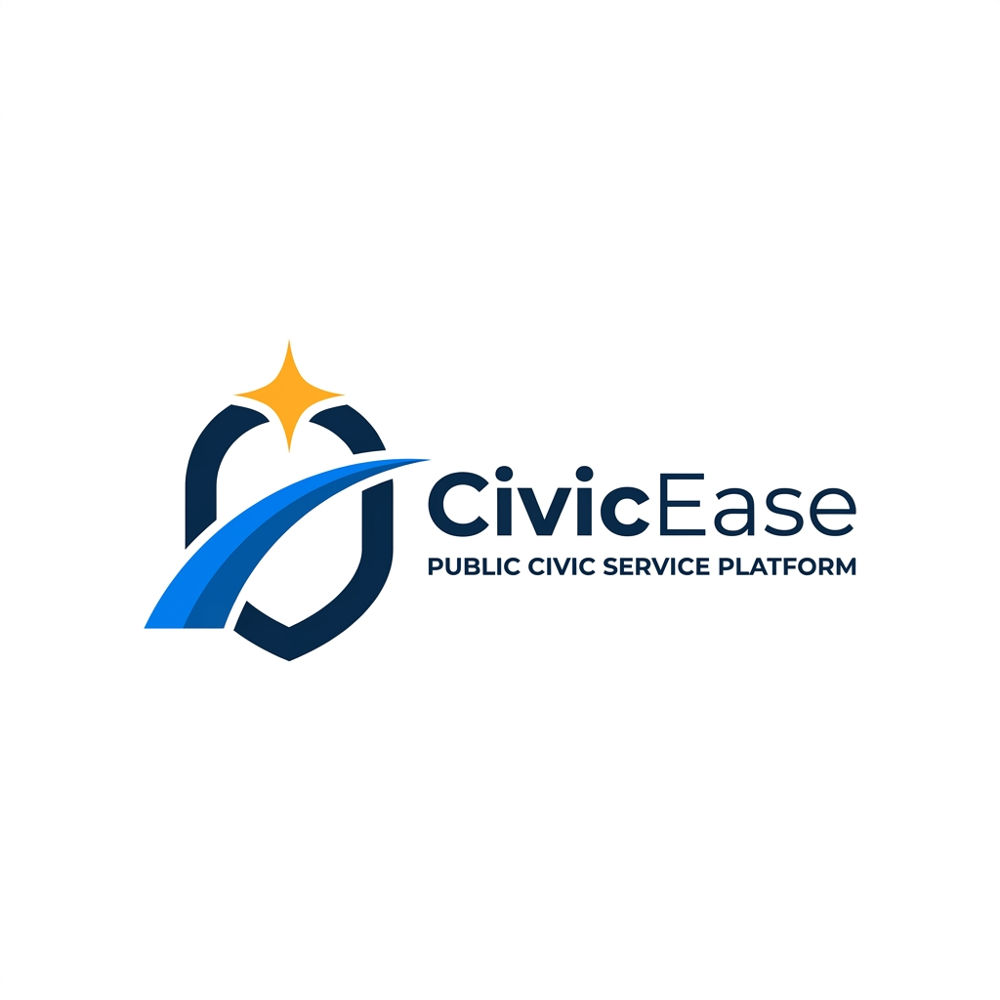
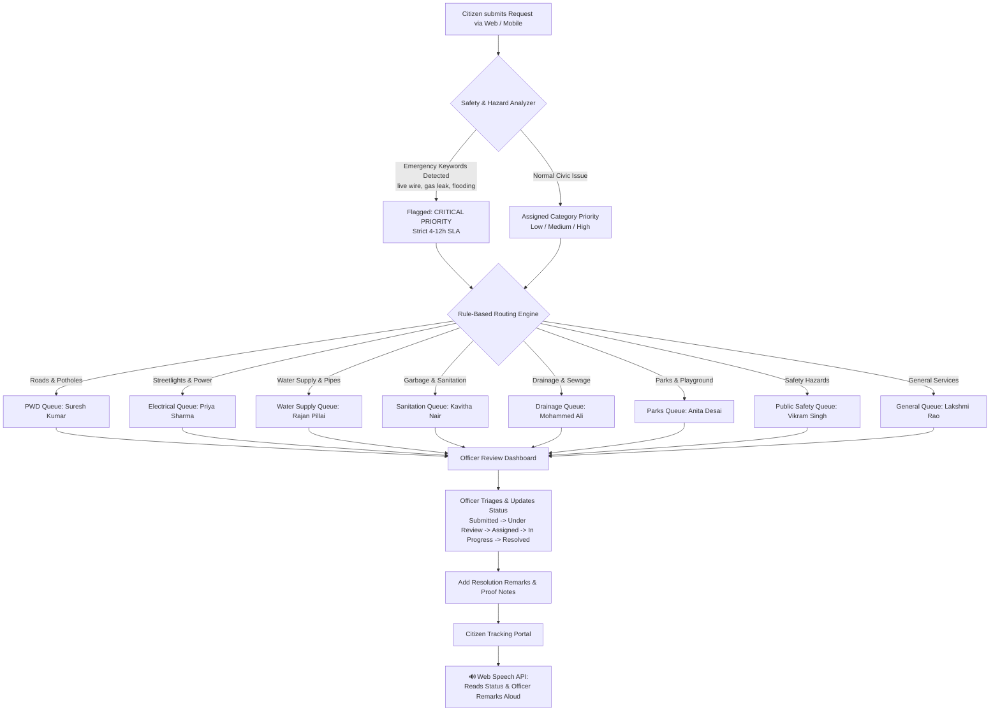

# CivicEase — Public Service & Grievance Redressal Portal

<p align="center">
  
</p>

<p align="center">
  <strong>Every Citizen Matters. Every Request Counts.</strong><br>
  <em>Accessible Digital Public Service & Grievance Redressal Portal for all citizens.</em>
</p>

---

## 🌐 Live Website & Direct Access Links

| Page / Feature | Direct Live Link | Description |
| :--- | :--- | :--- |
| **Citizen Home Portal** | [Open CivicEase Portal](https://hskruthika814.github.io/Public-Services-Within-Everyone-s-Reach/) | Landing page, civic service overview, accessibility controls (contrast & font resizing). |
| **Submit Service Request** | [Submit Complaint](https://hskruthika814.github.io/Public-Services-Within-Everyone-s-Reach/#/submit) | Multi-step submission form with automatic priority detection & contact capture. |
| **Track Request (with Audio)** | [Track Complaint Status](https://hskruthika814.github.io/Public-Services-Within-Everyone-s-Reach/#/track) | Real-time status lookup, timeline history, and **🔊 Read Status Aloud** (Web Speech API). |
| **Access & Login Portal** | [Sign In / Create Account](https://hskruthika814.github.io/Public-Services-Within-Everyone-s-Reach/#/login) | Tabbed authentication for Citizens (instant name & mail) and Officers (credentials & 1-click access). |
| **Review Dashboard (Officer Console)** | [Officer Review Dashboard](https://hskruthika814.github.io/Public-Services-Within-Everyone-s-Reach/#/dashboard) | Dedicated review console with 8 department isolation queues, review metrics, and resolution notes. |
| **Unified Single-Page Portal** | [Unified Portal](https://hskruthika814.github.io/Public-Services-Within-Everyone-s-Reach/portal.html) | Standalone single-file portal version for offline & backup usage. |

---

## 🚀 How CivicEase Works: End-to-End Workflow

CivicEase connects citizens directly with municipal department officers through an automated, transparent grievance redressal lifecycle.



---

## 📋 Detailed Workflow Stages

### 1. Request Submission & Smart Safety Analysis
- **Citizen Entry:** Citizens can file a grievance with or without an existing account. Name, email, and optional phone number are captured.
- **Automated Hazard Detection:** The intake analyzer evaluates the complaint description for life-threatening keywords (e.g., *“live wire”*, *“gas leak”*, *“flood”*, *“sparking”*).
- **Instant Escalation:** If an emergency keyword is found, the priority is immediately bumped to **Critical** with a mandatory 4-hour SLA.
- **Unique Tracking Code:** Every ticket is assigned a permanent reference ID (e.g. `CE-2026-1002`).

### 2. Deterministic Municipal Department Routing
Every service category routes directly to the specialized department officer responsible for that domain:

| Department Code | Department Name | Assigned Lead Officer | Primary Service Domain |
| :---: | :--- | :--- | :--- |
| **PWD** | Public Works Department | **Suresh Kumar** | Roads, potholes, pavements, bridges, and infrastructure |
| **ELEC** | Electrical Department | **Priya Sharma** | Streetlights, transformers, electrical cables, power cuts |
| **WATER** | Water Supply Department | **Rajan Pillai** | Drinking water pipelines, valve leakages, borewells |
| **SANIT** | Sanitation Department | **Kavitha Nair** | Garbage collection, solid waste, neighborhood bins |
| **DRAIN** | Drainage Department | **Mohammed Ali** | Stormwater drains, sewage overflow, culvert blockages |
| **PARKS** | Parks & Public Facilities | **Anita Desai** | Public parks, playground equipment, public benches |
| **SAFETY** | Public Safety Department | **Vikram Singh** | Open manholes, structural dangers, safety barricades |
| **GEN** | General Services | **Lakshmi Rao** | Encroachments, miscellaneous civic requests |

### 3. Department Isolation & Review Console
- **Strict Data Isolation:** When Officer Priya Sharma (ELEC) logs in, her dashboard strictly displays complaints assigned to the Electrical Department.
- **Administrator Oversight:** System Administrators have complete visibility across all 8 department queues simultaneously.
- **Review Counters & Audit Trail:** Officers can mark complaints as "Reviewed", record investigation notes, update status codes (`Submitted` ➔ `Under Review` ➔ `Assigned` ➔ `In Progress` ➔ `Resolved`), and store timestamps.

### 4. Real-Time Tracking & Voice Accessibility
- **Timeline Tracking:** Citizens enter their tracking reference number (`CE-2026-XXXX`) on `/track` to see the chronological timeline of updates.
- **🔊 Text-to-Speech (TTS):** Integrated Web Speech API reads the ticket ID, current status, assigned officer, and latest resolution notes out loud in English (with Kannada language toggle support).

---

## 🔐 Authentication & Session Architecture

CivicEase features a dual-mode authentication layer designed to operate seamlessly **both offline on static hosting (GitHub Pages) and connected to the Flask REST backend**:

1. **Citizen Portal (Zero Friction):**
   - Requires only **Full Name** and **Mail ID**.
   - No complex passwords or email confirmations required for emergency reports.
   - User profile is saved in browser storage (`localStorage: civicease_user`) to survive page reloads and browser restarts.

2. **Department Officer & Staff Portal:**
   - Supports standard email & password verification against the backend database.
   - Includes **1-Click Quick Demo Login** buttons for all 8 Department Officers, Supervisor, and System Administrator.
   - Falls back gracefully to local session tokens when running statically on GitHub Pages.

---

## 🔑 Pre-Configured Demo Accounts

| Role / Department | Officer Name | Email | Password | Access Scope |
| :--- | :--- | :--- | :--- | :--- |
| **Administrator** | System Admin | `admin@civicease.demo` | `Admin@123` | Full access to all 8 department queues |
| **Supervisor** | Supervisor Singh | `supervisor@civicease.demo` | `Super@123` | Escalated tickets & supervisor review |
| **PWD Staff** | Suresh Kumar | `staff.pwd@civicease.demo` | `Staff@123` | Public Works & Roads complaints |
| **Electrical Staff** | Priya Sharma | `staff.elec@civicease.demo` | `Staff@123` | Streetlights & Electrical issues |
| **Water Supply Staff**| Rajan Pillai | `staff.water@civicease.demo` | `Staff@123` | Water pipelines & supply issues |
| **Sanitation Staff** | Kavitha Nair | `staff.sanit@civicease.demo` | `Staff@123` | Garbage & Sanitation queue |
| **Drainage Staff** | Mohammed Ali | `staff.drain@civicease.demo` | `Staff@123` | Drainage & Sewage complaints |
| **Parks Staff** | Anita Desai | `staff.parks@civicease.demo` | `Staff@123` | Parks & Public Amenities queue |
| **Public Safety Staff**| Vikram Singh | `staff.safety@civicease.demo` | `Staff@123` | Safety hazards & emergency tickets |
| **General Staff** | Lakshmi Rao | `staff.gen@civicease.demo` | `Staff@123` | General service requests |
| **Registered Citizen**| Aisha Citizen | `citizen1@civicease.demo` | `Citizen@123` | Pre-seeded citizen complaint history |

---

## 🛠️ Technology Stack

```
Frontend:
├── React 18 + TypeScript
├── Vite (Production Bundler)
├── Tailwind CSS + Custom Gov Theme
├── Lucide React Icons
└── Web Speech API (Voice status synthesis)

Backend (Optional for Local API Server):
├── Python 3.10+ / Flask
├── SQLAlchemy ORM + SQLite
├── Flask-JWT-Extended (Token security)
├── Flask-Migrate & Flask-Limiter
└── Werkzeug Password Hashing
```

---

## 💻 Running Locally

### 1. Clone the Repository
```bash
git clone https://github.com/hskruthika814/Public-Services-Within-Everyone-s-Reach.git
cd Public-Services-Within-Everyone-s-Reach
```

### 2. Frontend Development Server
```bash
cd frontend
npm install
npm run dev
# Vite runs at http://localhost:5173/
```

### 3. Backend Flask API Server (Optional)
```bash
cd backend
python -m venv venv
venv\Scripts\activate      # On Windows
pip install -r requirements.txt
python app.py
# Backend API runs at http://localhost:5000/
```

### 4. Build for Production / GitHub Pages
```bash
cd frontend
npm run build
# Built files output to frontend/dist and are served at root index.html
```

---

## 🖥️ Desktop Shortcut Launchers

The project includes pre-configured Windows launchers:
- **`CivicEase.url`**: Double-click to open in your default browser.
- **`open_in_chrome.bat`**: Launches Google Chrome directly to the live portal.
- **`open_in_firefox.bat`**: Launches Mozilla Firefox (or falls back to Chrome/Default).
- **`Open_CivicEase.bat`**: Universal launcher with automatic browser detection.
